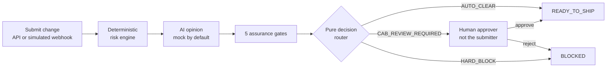
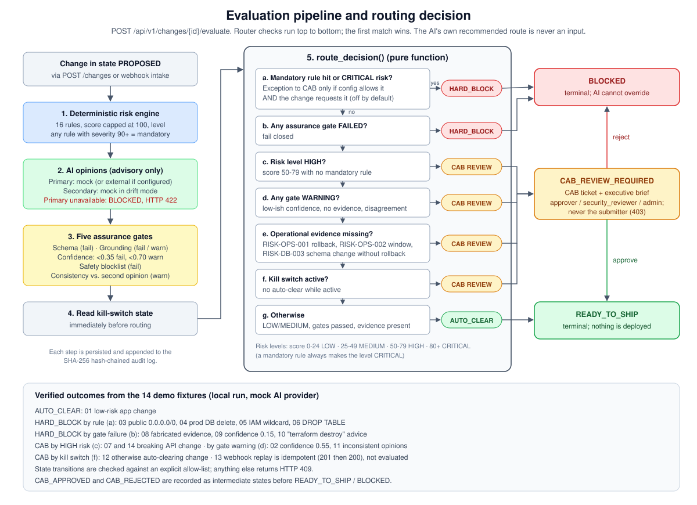
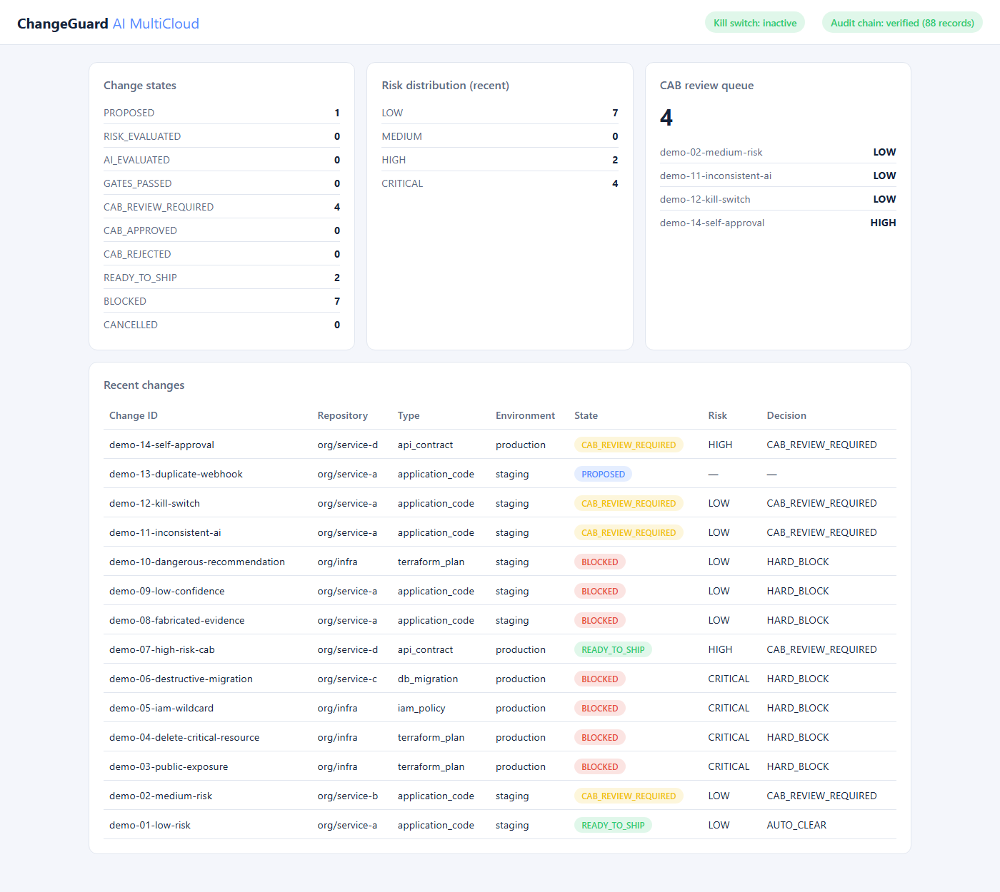

# ChangeGuard AI MultiCloud

A proof-of-concept service that decides whether a proposed infrastructure or code change can proceed. Deterministic rules decide, AI only advises, and a person approves anything risky.

**Portfolio category: System Design & Architecture.** This project shows how to put deterministic controls, validation of AI output, and human approval around a release decision. It is a working POC, not a production platform.

## What it does

You submit a change: application code, Terraform plan, DB migration, IAM policy, API contract, or configuration. ChangeGuard scores its risk with fixed rules, asks an AI provider for an advisory summary, checks that summary with five validation gates, and routes the change to one outcome:

- **`AUTO_CLEAR`**: low or medium risk with all checks passed. The change is marked ready to ship.
- **`CAB_REVIEW_REQUIRED`**: a human approver who is not the submitter must approve or reject it.
- **`HARD_BLOCK`**: a mandatory rule was violated or an AI check failed. Nothing overrides this.

Every step is recorded in a hash-chained audit log. The service never deploys, merges, or calls a cloud API itself.

## Why

Many outages come from a single risky change, such as a security group opened to the internet, a dropped table, or a wildcard IAM policy. AI can review changes quickly, but it can also invent evidence or suggest unsafe actions. This project explores a design where AI speeds up review without ever getting the final say.

## How it works



The router never receives the AI's recommended route as an input. AI can only make the outcome stricter, by failing or warning on a gate.



## Implemented capabilities

- 16 deterministic risk rules (public network exposure, destructive Terraform, IAM wildcards, destructive SQL, missing rollback plan, and more) with an explainable score.
- Five gates on AI output: schema, grounding (no fabricated evidence), confidence, safety blocklist, and consistency with a second opinion.
- CAB approve/reject with separation of duties, plus an admin-only kill switch that turns off auto-clear.
- SHA-256 hash-chained audit log with a verification endpoint, and a read-only dashboard.
- Docker Compose stack (FastAPI, PostgreSQL 16, Alembic) and 78 automated tests.

The AI provider is an offline, deterministic **mock**. An external-provider adapter exists but is off by default and untested against a real endpoint. GitHub/GitLab intake is **simulated** (no signature checks), and the AWS/GCP Terraform is **reference only**: it has never been applied.



## Quick start

Requires Docker with Compose v2.

```bash
cp .env.example .env
docker compose up -d --build
docker compose exec app python demo/scripts/run_demo.py
```

Then open http://localhost:8000/dashboard or http://localhost:8000/docs. Stop with `docker compose down -v`.

Local Python setup, tests, and troubleshooting are covered in [Demo and Operations](docs/DEMO_AND_OPERATIONS.md).

## Documentation

- [Project Overview](docs/PROJECT_OVERVIEW.md): problem, users, capabilities, scope, and an example.
- [Architecture](docs/ARCHITECTURE.md): components, data flow, deployment, design tradeoffs, and integration status.
- [Demo and Operations](docs/DEMO_AND_OPERATIONS.md): setup, configuration, demo walkthrough, and troubleshooting.
- [Governance and Validation](docs/GOVERNANCE_AND_VALIDATION.md): oversight, security controls, tests, and limitations.
