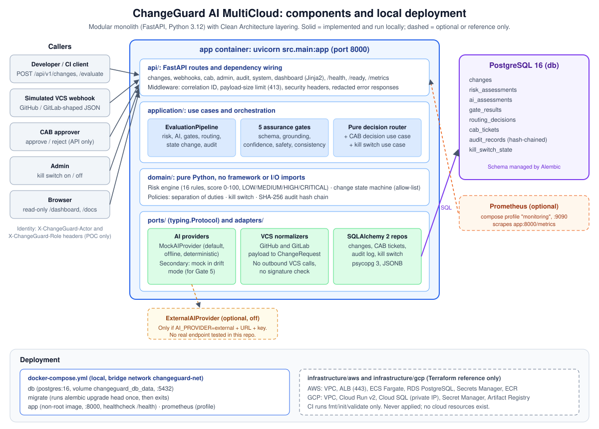
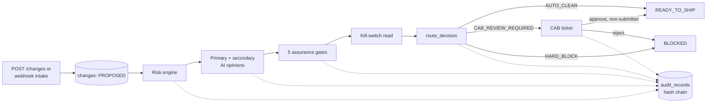

# Architecture

ChangeGuard AI MultiCloud is a **modular monolith**: a single FastAPI process backed by a single PostgreSQL database. Inside the process, the code follows Clean Architecture layering. Business rules live in plain Python with no framework imports, and infrastructure is reached only through `typing.Protocol` ports.

*Solid boxes are implemented and were run locally. Dashed boxes are optional (Prometheus, external AI) or reference-only (Terraform).*

## Components and responsibilities

| Layer / component | Location | Responsibility |
| --- | --- | --- |
| API | `src/api/` | FastAPI routes, request/response schemas (Pydantic v2), dependency wiring, actor-header parsing |
| App entry point | `src/main.py` | App factory, middleware (correlation ID, payload size limit, security headers), maps exceptions to redacted HTTP errors, seeds the kill switch at startup |
| Evaluation pipeline | `src/application/orchestration/evaluation_pipeline.py` | Runs risk → AI → gates → routing → state change. Persists each artifact and writes an audit record for each step |
| Assurance gates | `src/application/evaluation/` | Schema, grounding, confidence, safety, and consistency checks on AI output |
| Decision router | `src/application/routing/decision_router.py` | Pure function that turns risk + gate results + kill-switch state into one decision |
| Use cases | `src/application/use_cases/` | Submit change, evaluate, CAB decision, kill switch, verify audit chain |
| Risk engine | `src/domain/risk/` | 16 rule functions and the scoring/level logic. No AI, no I/O |
| State machine | `src/domain/state_machine/transitions.py` | Allow-list of legal change-state transitions |
| Policies | `src/domain/policies/` | Separation of duties, kill-switch authority, audit hash-chain rules |
| Ports | `src/ports/` | Protocols for AI providers, VCS normalizers, and the four repositories |
| AI adapters | `src/adapters/ai/` | `MockAIProvider` (default), `ExternalAIProvider` (optional) |
| VCS adapters | `src/adapters/vcs/`, `src/adapters/webhook/` | Turn GitHub/GitLab-shaped payloads into a `ChangeRequest` |
| Persistence | `src/adapters/persistence/` | SQLAlchemy 2 ORM models and repositories (psycopg 3, JSONB) |
| Observability | `src/observability/` | JSON logging, correlation IDs, Prometheus metric definitions (only `changeguard_http_errors_total` is currently incremented) |
| Security helpers | `src/security/` | Actor-context parsing and secret redaction |
| Dashboard | `templates/dashboard.html`, `static/css/` | Server-rendered, read-only status page |
| Migrations | `migrations/` | One Alembic revision with the initial schema |

## Technologies

Python 3.12 · FastAPI 0.115 · Uvicorn · Pydantic v2 / pydantic-settings · SQLAlchemy 2.0 · psycopg 3 · Alembic · PostgreSQL 16 · Jinja2 · python-json-logger · prometheus-client · Docker / Docker Compose · Terraform (reference) · Pytest / Ruff · GitHub Actions.

SQLite is not used anywhere. Tests that need a database use real PostgreSQL.

## Data and control flow

Evaluation runs **synchronously** inside the `/evaluate` request. The pipeline:

1. Checks that the state transition is allowed, runs `evaluate_risk()`, stores the `RiskAssessment`, and moves the change to `RISK_EVALUATED`.
2. Reads the kill-switch state, then calls the primary AI provider. If the primary provider fails, the change is forced to `BLOCKED` and the API returns HTTP 422. If the secondary provider fails, that is audited, and Gate 5 is recorded as `SKIPPED`.
3. Stores both AI assessments and moves the change to `AI_EVALUATED`.
4. Runs all five gates and stores every result, including `SKIPPED` ones. A schema failure skips gates 2–4. The state moves to `GATES_PASSED`. That name means the gates *ran*; failures are handled by the router.
5. Reads the kill-switch state again. This second read is the one the router uses.
6. Calls `route_decision()`, stores the decision, moves the change to the target state, and creates a CAB ticket when one is needed.

The kill switch is read twice, but only the second read reaches the router. Activating it at any point before routing therefore prevents auto-clear.

### Persistence

Eight tables (`migrations/versions/a04e6d56c775_initial_schema.py`): `changes`, `risk_assessments`, `ai_assessments`, `gate_results`, `routing_decisions`, `cab_tickets`, `audit_records`, `kill_switch_state`. Each audit record stores `sequence`, `previous_hash`, `canonical_payload`, and `current_hash = SHA-256(previous_hash + canonical_payload)`, starting from a genesis hash of 64 zeros.

## Deployment structure

**Local (implemented):** `docker-compose.yml` defines:

| Service | Purpose |
| --- | --- |
| `db` | `postgres:16`, named volume `changeguard_db_data`, port 5432, `pg_isready` health check |
| `migrate` | Same image as the app. Runs `alembic upgrade head` once, then exits |
| `app` | Multi-stage `python:3.12-slim` image, non-root `changeguard` user, port 8000, `/health` health check. Starts only after `db` is healthy and `migrate` has completed |
| `prometheus` | Optional, behind the `monitoring` profile. Port 9090, scrapes `app:8000/metrics` |

The Dockerfile copies any CA certificates in `certs/` into the build stage. This supports networks with TLS inspection. The folder is empty by default.

**Cloud (reference only):** `infrastructure/aws` and `infrastructure/gcp` describe one possible hosting layout:

- **AWS:** VPC with public/private subnets and NAT, an ALB (HTTPS 443 only), ECS Fargate (1 task), RDS PostgreSQL (not publicly accessible, single-AZ), Secrets Manager, ECR, and CloudWatch Logs.
- **GCP:** VPC with a serverless subnet, Cloud Run v2, Cloud SQL (private IP only), Secret Manager, Artifact Registry, and a dedicated service account. Unauthenticated Cloud Run access is controlled by a variable.

This repository never applies the Terraform, and no cloud environment exists because of it. CI only runs `terraform fmt -check`, `init -backend=false`, and `validate`.

## Key design decisions and tradeoffs

| Decision | Why | Tradeoff |
| --- | --- | --- |
| Modular monolith, not microservices | One deployable unit is enough for a POC and keeps the transaction and audit story simple | Evaluation can't scale independently of the API |
| Rules as plain Python functions (`RULE_REGISTRY`) | Easy to read, unit test, and extend. No custom rule language | Changing policy means changing code. There is no runtime rule editing |
| Router doesn't accept the AI's route | AI can't override a block by design, not just by convention | AI insight affects routing only through gate outcomes |
| Fail closed everywhere | A failed gate, primary-AI outage, or illegal transition leads to block or error, never auto-clear | More changes need human review |
| Second opinion from the same mock in drift mode | Gate 5 can run with no external dependency | It shows the mechanism, not real model disagreement |
| Synchronous pipeline in the request | Simple, deterministic, easy to test | A slow real AI provider would hold the HTTP request open |
| Hash chain in the same database | Detects edits, reordering, and deletions with no extra infrastructure | Someone with database write access could rewrite the whole chain consistently |
| Header-based identity | Keeps the POC runnable without an IdP | Not authentication. Any client can claim any role |
| PostgreSQL-only, including tests | Tests exercise real JSONB, cascades, and migrations | Integration tests need a running database |

## Integration status

| Integration | Status |
| --- | --- |
| PostgreSQL 16 | **Working.** Used by the app, migrations, and the integration/e2e tests |
| Mock AI provider (primary and secondary) | **Working, simulated.** Deterministic. Fixtures can trigger failure modes via `metadata._demo` |
| External AI provider | **Optional, not verified.** Used only when `CHANGEGUARD_AI_PROVIDER=external` and both URL and key are set. It posts to `{base_url}/v1/changeguard/analyze`, a custom path, not a standard vendor API. No test or demo calls a real endpoint. The secondary opinion stays on the mock either way |
| GitHub / GitLab | **Simulated intake only.** Turns webhook-shaped JSON into a change. No outbound API calls, no signature checks, and evaluation is not triggered automatically |
| Prometheus | **Optional.** Scrape config is included and `/metrics` responds. Decision, risk-level, gate-failure, and duration metrics are defined but not yet wired into the pipeline, so they stay at zero |
| AWS / GCP | **Reference Terraform only.** Not deployed |
