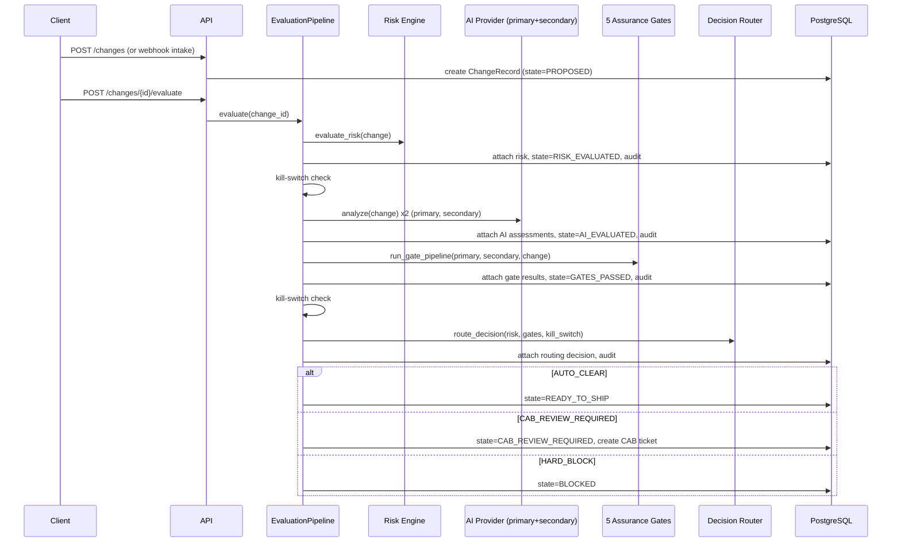

# Architecture

## System context

```mermaid
flowchart TB
    subgraph External
        VCS[GitHub/GitLab webhook\n(simulated)]
        CAB_Actor[CAB approver/security reviewer]
        Admin[Admin]
    end

    subgraph ChangeGuard
        API[FastAPI]
        Pipeline[Evaluation Pipeline]
        DB[(PostgreSQL 16)]
        Dashboard[Read-only dashboard]
    end

    VCS -->|webhook + changeguard extension| API
    CAB_Actor -->|X-ChangeGuard-Actor/Role headers| API
    Admin -->|kill-switch admin| API
    API --> Pipeline
    Pipeline --> DB
    API --> Dashboard
    Dashboard --> DB
```

## Component responsibilities and module boundaries

```
src/domain/          Pure business rules. No FastAPI, SQLAlchemy, or cloud SDK imports.
  entities/          ChangeRequest, RiskAssessment, AIAssessment, GateResult, CabTicket,
                      AuditRecord, RoutingDecision, ChangeRecord (aggregate)
  enums/             ChangeType, RiskLevel, ChangeState, Decision, ActorRole, GateName
  risk/              Deterministic rule catalog (rules.py) + engine (engine.py)
  state_machine/     Explicit transition allow-list (transitions.py)
  policies/          Kill-switch policy, separation-of-duties, audit-chain hashing

src/application/     Orchestrates domain logic; still infrastructure-agnostic.
  evaluation/        The 5 assurance gates + pipeline runner
  routing/           The pure decision router (route_decision)
  orchestration/     EvaluationPipeline (the full risk->AI->gates->routing->CAB flow),
                      CAB ticket builder
  use_cases/         Thin, single-purpose application services the API calls into

src/ports/           typing.Protocol interfaces: AIProvider, VCSProvider, ChangeRepository,
                      CabRepository, AuditRepository, KillSwitchRepository

src/adapters/        Concrete implementations of the ports above.
  ai/                MockAIProvider (default, offline, deterministic), ExternalAIProvider
                      (disabled unless explicitly configured)
  vcs/                GitHubVCSProvider, GitLabVCSProvider — normalize provider payloads
  persistence/       SQLAlchemy 2.x models, mappers (ORM <-> domain entities), repository
                      implementations, hash-chained audit repository
  webhook/           Dispatches a raw payload to the right VCS adapter by provider key

src/api/             FastAPI routes, Pydantic request/response schemas, dependency wiring
src/observability/   Structured JSON logging, correlation IDs, Prometheus metrics
src/security/        Redaction, actor/role header parsing
src/main.py          App factory: middleware, exception handlers, router mounting
```

**Dependency direction** is strictly inward: `api -> application -> domain`, with `adapters`
implementing `ports` that `application` depends on as abstractions (dependency inversion).
Nothing under `domain/` imports FastAPI, SQLAlchemy, or any cloud SDK — this is enforced by
convention and by the unit test suite running with zero I/O.

## End-to-end data flow



## State machine

```
PROPOSED -> RISK_EVALUATED -> AI_EVALUATED -> GATES_PASSED
GATES_PASSED -> READY_TO_SHIP | CAB_REVIEW_REQUIRED | BLOCKED
CAB_REVIEW_REQUIRED -> CAB_APPROVED | CAB_REJECTED
CAB_APPROVED -> READY_TO_SHIP
CAB_REJECTED -> BLOCKED
(PROPOSED | RISK_EVALUATED | AI_EVALUATED | GATES_PASSED) -> CANCELLED
```

The full allow-list lives in `src/domain/state_machine/transitions.py` as an explicit
`dict[ChangeState, frozenset[ChangeState]]`. `validate_transition()` raises
`InvalidStateTransitionError` (mapped to HTTP 409) for anything not listed — there is no
implicit or "convenience" transition anywhere in the codebase.

## Provider protocols

Three abstraction seams, all `typing.Protocol`:

- **`AIProvider`** (`analyze(change) -> AIAssessment`). Swappable without touching the
  pipeline, gates, or router. `MockAIProvider` is the default and the only provider any
  automated test depends on.
- **`VCSProvider`** (`normalize(raw_payload) -> ChangeRequest`). `GitHubVCSProvider` and
  `GitLabVCSProvider` translate provider-specific webhook shapes into the same normalized
  `ChangeRequest` the rest of the system operates on.
- **Repository ports** (`ChangeRepository`, `CabRepository`, `AuditRepository`,
  `KillSwitchRepository`). One SQLAlchemy implementation each; test doubles
  (`tests/fixtures/fake_repositories.py`) implement the same protocols for fast,
  DB-free tests of the pipeline and API layer.

## Database and audit architecture

Eight tables (see `src/adapters/persistence/models.py` and the single Alembic migration):
`changes`, `risk_assessments`, `ai_assessments`, `gate_results`, `routing_decisions`,
`cab_tickets`, `audit_records`, `kill_switch_state`. All child tables cascade-delete from
`changes`. JSONB columns hold structured evidence (triggered rules, gate details, evidence
lists) without over-normalizing into dozens of join tables — a deliberate simplicity choice
for a POC of this scope.

`audit_records` is the tamper-evident log: each row's `current_hash =
SHA256(previous_hash || canonical_payload)`. `SqlAlchemyAuditRepository.append()` takes a
`SELECT ... FOR UPDATE` lock on the latest row before computing the next sequence/hash, so
concurrent writers cannot race and produce two records both claiming the same
`previous_hash`. See `docs/AI_ASSURANCE_AND_GOVERNANCE.md` and
`docs/TRADEOFFS_AND_PRODUCTION_ROADMAP.md` for what "tamper-evident, not immutable" means
in practice.

## Key architecture decisions

| Decision | Why |
|---|---|
| Modular monolith over microservices | The whole evaluation pipeline is one coherent transaction; splitting it into services would add network calls and eventual-consistency risk for no benefit at this scale. |
| Synchronous pipeline over a queue | Simpler to reason about and to test end-to-end; a POC-appropriate tradeoff explicitly flagged for revisit in production (see roadmap). |
| Router never sees the AI's own recommendation | Structural (type-level) guarantee that AI cannot influence routing, not just a policy statement. |
| Two AI calls (primary + drift-capable secondary) for every evaluation | Makes Gate 5 (consistency) meaningfully testable/demoable without needing two different real model providers. |
| JSONB over deep relational normalization for evidence | Evidence is written once, read as a whole; normalizing it into extra tables would add migration/query complexity with no query pattern that needs it. |
